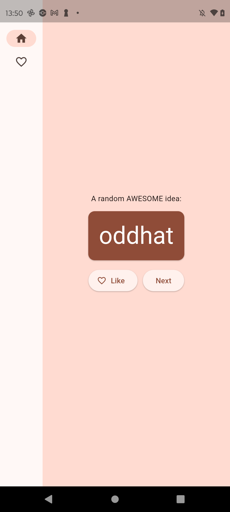
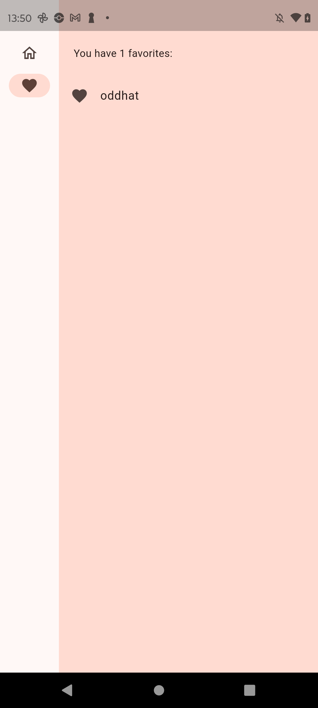

# Atividade 6 — Meu primeiro app Flutter

Aplicativo de geração de nomes feito a partir do [codelab oficial do Flutter](https://codelabs.developers.google.com/codelabs/flutter-codelab-first?hl=pt-br#0). Ele gera pares de palavras, permite marcar e desmarcar favoritos e mostra a lista de favoritos em outra tela. A navegação se adapta a telas estreitas e largas.

## Executar no Android

1. Instale o Flutter e o Android SDK e confira o ambiente com `flutter doctor`.
2. No celular, ative as Opções do desenvolvedor e a Depuração USB.
3. Conecte-o ao Mac com um cabo de dados e autorize a chave de depuração no celular.
4. Confirme o reconhecimento com `adb devices` e `flutter devices`.
5. Neste diretório, execute `flutter pub get` e `flutter run`.

## Telas executadas no moto g32

| Gerador de nomes | Lista de favoritos |
| --- | --- |
|  |  |

Os prints acima foram capturados da execução do app no aparelho Android conectado por USB.
